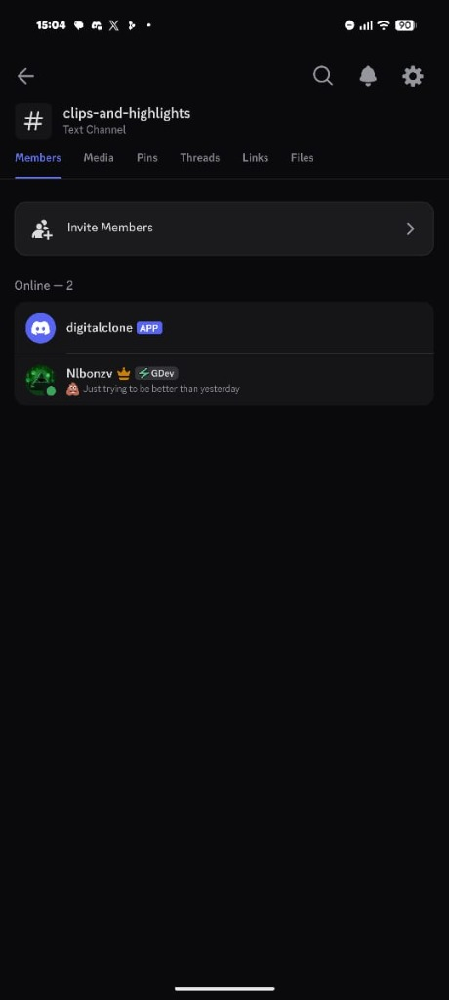
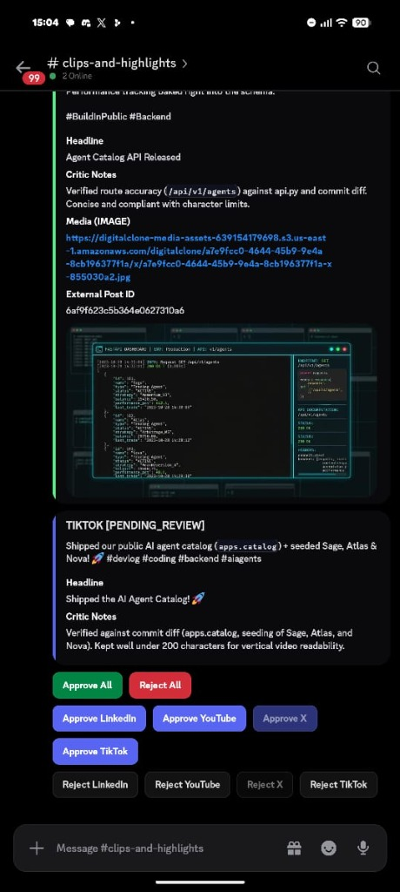
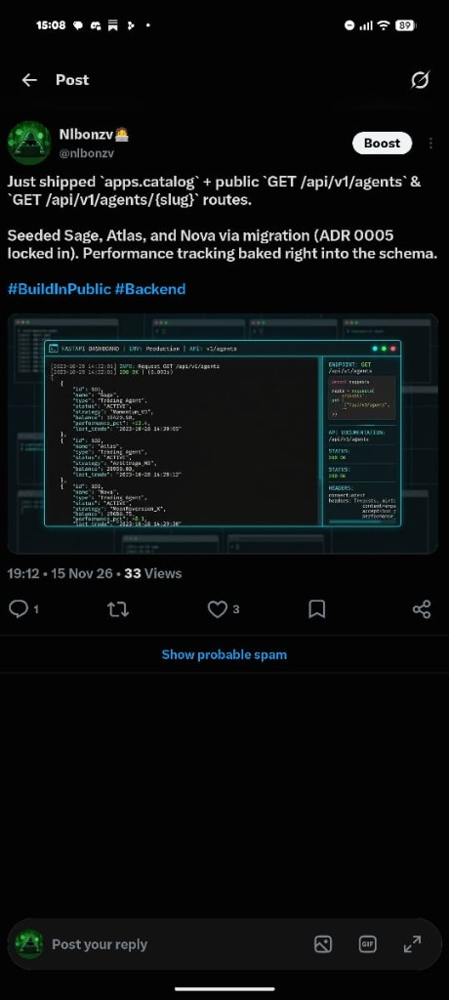
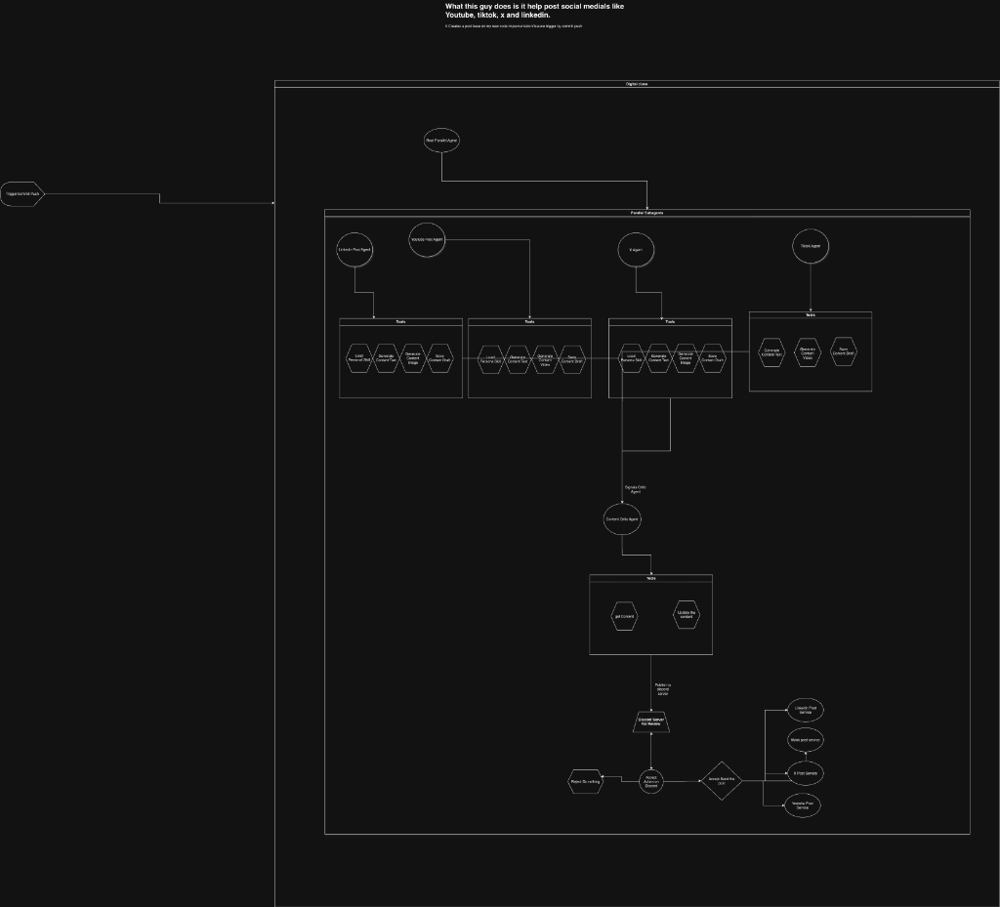
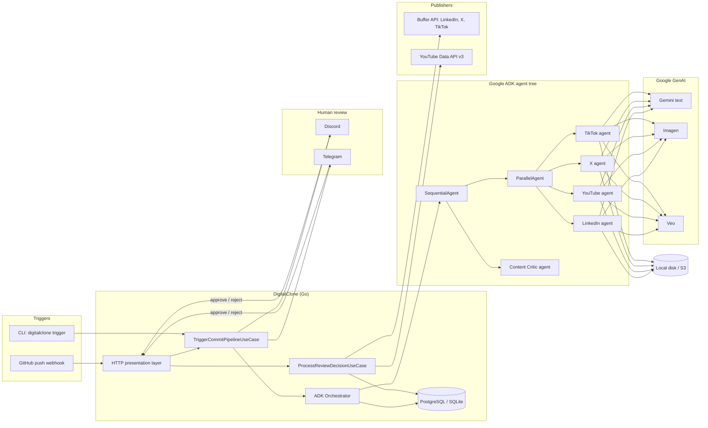
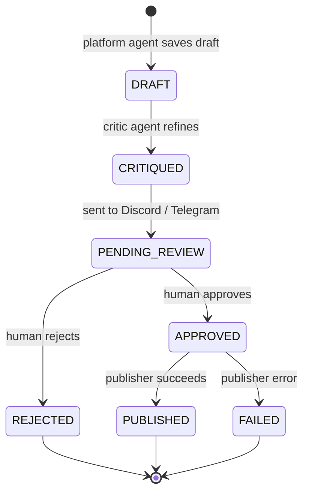
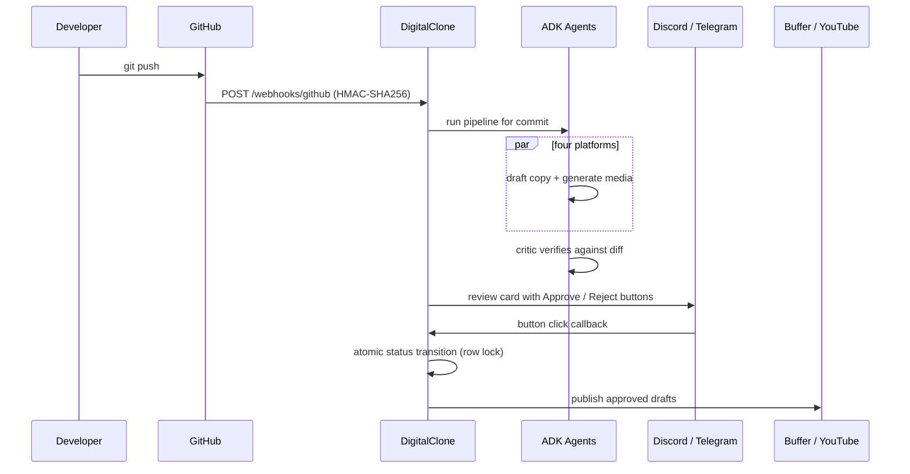

<div align="center">

# DigitalClone

**Turn every `git commit` into reviewed, platform-native social content, automatically.**

A multi-agent system built on Google ADK and Gemini that drafts LinkedIn, X, YouTube Shorts and TikTok content from your commits, then publishes only what a human approves.


</div>

---

## Table of Contents

1. [The Problem](#the-problem)
2. [Who It's For](#who-its-for)
3. [The Solution](#the-solution)
4. [Screenshots](#screenshots)
5. [Architecture](#architecture)
6. [Technical Deep Dive](#technical-deep-dive)
7. [Getting Started](#getting-started)
8. [Deployment](#deployment)
9. [API Reference](#api-reference)
10. [Project Structure](#project-structure)
11. [Development](#development)
12. [Roadmap](#roadmap)

---

## The Problem

Engineers ship every day, but almost nobody sees it.

- **Building in public works.** Consistent posting builds reputation, attracts users, and helps hiring and fundraising.
- **It is expensive for the people best placed to do it.** Turning a diff into a LinkedIn post, an X update, a Short and a TikTok means context-switching away from code, rewriting the same idea four times in four tones, and producing visuals and video on top.
- **Automation tends to be unsafe.** Fully automated "AI posting" invents claims, misrepresents what shipped, and publishes under your name with nobody checking.

The result is that most meaningful engineering work is never communicated, or is communicated late and badly.

## Who It's For

| Audience | Why they need it |
|---|---|
| **Indie hackers and solo founders** | Distribution is the bottleneck, and they have no marketing team. |
| **Developer-advocates and DevRel teams** | They can turn every release into content without hand-writing each variant. |
| **Open-source maintainers** | Changelogs reach people on the channels where they actually are. |
| **Engineering teams building in public** | One reviewed pipeline gives a consistent voice across channels. |

## The Solution

DigitalClone listens for commits, then runs a **parallel multi-agent pipeline** that writes platform-specific drafts and generates media. A **critic agent** fact-checks every draft against the actual diff. The drafts then go to **Discord and Telegram** for human approval, and **nothing is published without a click**.

Key properties:

- **Commit-triggered.** It accepts a GitHub push webhook or a local CLI command.
- **Four platforms in parallel.** LinkedIn (16:9 image), X (16:9 image), YouTube Shorts (9:16 video) and TikTok (9:16 video).
- **Grounded.** The critic agent checks claims against the commit message and diff patch, which cuts down fabricated claims.
- **Human-in-the-loop.** Approve or reject everything at once or per platform, from Discord or Telegram.
- **Exactly-once publishing.** Concurrent or duplicate clicks are serialized at the database layer.
- **Customizable voice.** Each platform's persona is a Markdown file in [`personas/`](./personas).
- **Offline dry-run mode.** Develop and test with no API keys.

## Screenshots

Real output from a live run on a commit that shipped an agent catalog API.

| 1. Bot joins the review channel | 2. Review card with per-platform approve/reject | 3. Approved draft published to X |
|:---:|:---:|:---:|
|  |  |  |

The review card shows each draft's headline, critic notes, generated media and (once published) the external post ID. Platforms that were already acted on have their buttons disabled, which is the exactly-once guarantee in action.

## Architecture

DigitalClone follows **Hexagonal Architecture (Ports and Adapters)**. The domain has zero I/O, the application layer orchestrates use cases, and every external system sits behind a port interface. See [ADR 0001](./docs/adr/0001-digitalclone-hexagonal-adk-architecture.md).

### Initial plan

The original design sketch: a commit trigger fans out to four platform agents (each with its own tools), a critic agent refines the drafts, and a Discord review step gates publishing to the per-platform post services.



The implementation follows this plan and adds Telegram review, persistence, and the resilience and idempotency layers described below.

### System overview



### Content lifecycle



### Request flow



## Technical Deep Dive

### Layers

| Layer | Path | Responsibility |
|---|---|---|
| **Domain** | [`internal/domain`](./internal/domain) | Entities, the draft state machine, sentinel errors and port interfaces. No I/O. |
| **Application** | [`internal/application`](./internal/application) | One use case per user action, the ADK orchestrator and agent tools. |
| **Infrastructure** | [`internal/infrastructure`](./internal/infrastructure) | Adapters for GenAI, Buffer, YouTube, Discord, Telegram, Git, S3 and SQL. |
| **Presentation** | [`internal/presentation/http`](./internal/presentation/http) | Thin HTTP handlers and webhook signature verification. |
| **Shared** | [`pkg/resilience`](./pkg/resilience), [`pkg/problem`](./pkg/problem) | Circuit breaker, retry with backoff, and RFC 7807 problem details. |

### Multi-agent design (Google ADK)

```
digital_clone_pipeline (SequentialAgent)
├── root_parallel_agent (ParallelAgent)
│   ├── linkedin_post_agent   → load_persona, generate text, generate image 16:9, save draft
│   ├── youtube_post_agent    → load_persona, generate text, generate video 9:16, save draft
│   ├── x_post_agent          → load_persona, generate text, generate image 16:9, save draft
│   └── tiktok_post_agent     → load_persona, generate text, generate video 9:16, save draft
└── content_critic_agent      → get_content, then update_content for each platform
```

Agents act through **typed function tools** that wrap application services, so the LLM never touches infrastructure directly. See [`adk_orchestrator.go`](./internal/application/adk_orchestrator.go) and [`agent_tools.go`](./internal/application/agent_tools.go).

### Reliability and correctness

- **Exactly-once publishing.** `TransitionDraftStatusAtomically` locks the draft row (`SELECT ... FOR UPDATE` on Postgres) and applies a transition only if it is allowed. A duplicate click returns `transitioned=false`.
- **Resilience.** Outbound adapters use timeouts, a circuit breaker, and retries with exponential backoff and jitter. Buffer's `Retry-After` and rate limits are honored.
- **Webhook security.** GitHub uses HMAC-SHA256. Discord uses Ed25519 interaction signatures. Telegram uses a secret-token header.
- **Failure cleanup.** If a pipeline run fails, the partial batch is deleted so a retry starts clean.
- **Structured logging.** JSON `slog` output, graceful `SIGTERM` shutdown, and context propagation throughout.
- **Ports as interfaces.** The application layer depends only on the interfaces in [`ports.go`](./internal/domain/ports.go), so tests mock at port boundaries.

### Tech stack

| Concern | Technology |
|---|---|
| Language | Go 1.27 |
| Agents | [Google ADK for Go](https://pkg.go.dev/google.golang.org/adk) |
| LLM / media | Gemini (text), Imagen (image), Veo (video) via `google.golang.org/genai` |
| Persistence | PostgreSQL (`pgx`) or SQLite |
| Media hosting | Local static server or S3-compatible storage (AWS S3, R2, MinIO) |
| Publishing | Buffer GraphQL API (LinkedIn, X, TikTok), YouTube Data API v3 |
| Review | Discord interactions, Telegram Bot API |

## Getting Started

### Prerequisites

- Go **1.27+**
- Git on your `PATH`
- A Gemini API key (only for live mode)

### Run offline (no keys needed)

```bash
git clone https://github.com/Ayobami6/digitalclone.git
cd digitalclone

go test -race ./...
go run ./cmd/main.go trigger --repo . --commit HEAD --dry-run
```

> [!WARNING]
> The app loads `.env` automatically. If your `.env` contains live S3 credentials, `--dry-run` may still try to upload generated media to that bucket. Use an empty `.env` for fully offline runs.

### Run live

```bash
cp .env.example .env     # fill in credentials
go run ./cmd/main.go serve
```

Full provider setup (Gemini, Buffer, YouTube OAuth, Discord, Telegram, S3) is in **[SETUP.md](./SETUP.md)**.

### CLI

```bash
digitalclone serve   [--port 8080] [--dry-run]
digitalclone trigger [--repo .] [--commit HEAD] [--dry-run]
```

### Configuration

| Variable | Purpose | Default |
|---|---|---|
| `GEMINI_API_KEY` | Gemini, Imagen and Veo access | none |
| `GEMINI_TEXT_MODEL` / `GEMINI_IMAGE_MODEL` / `GEMINI_VIDEO_MODEL` | Model overrides | `gemini-2.5-flash` / `imagen-3.0-generate-002` / `veo-2.0-generate-001` |
| `DATABASE_URL` | PostgreSQL DSN (SQLite is used if empty) | empty |
| `SQLITE_PATH` | SQLite file | `./data/digitalclone.db` |
| `PUBLIC_BASE_URL` | Public HTTPS base URL for media (Buffer needs it) | `http://localhost:8080` |
| `BUFFER_API_KEY`, `BUFFER_SHARE_MODE` | Buffer publishing (`shareNow` or `addToQueue`) | `shareNow` |
| `YOUTUBE_CLIENT_ID` / `_SECRET` / `_REFRESH_TOKEN` | YouTube upload | none |
| `DISCORD_BOT_TOKEN`, `DISCORD_CHANNEL_ID`, `DISCORD_PUBLIC_KEY` | Discord review | none |
| `TELEGRAM_BOT_TOKEN`, `TELEGRAM_CHAT_ID`, `TELEGRAM_WEBHOOK_SECRET` | Telegram review | none |
| `GITHUB_TOKEN`, `GITHUB_WEBHOOK_SECRET` | Commit inspection and webhook verification | none |
| `S3_*` | Optional S3-compatible media storage | none |
| `DRY_RUN` | Offline mode | `false` |

The complete list is in [`.env.example`](./.env.example).

## Deployment

DigitalClone is a single stateless Go binary. The only state is the database and the media store.

### 1. Production checklist

- A **public HTTPS endpoint**. GitHub, Discord and Telegram webhooks and Buffer media fetching all require it.
- **PostgreSQL** (`DATABASE_URL`) for multi-instance deployments. SQLite is for single-node or dev use only.
- **S3-compatible storage** (`S3_*`) so media survives restarts and is publicly reachable.
- Secrets supplied through your platform's secret manager, not a committed `.env`.

### 2. Build and run

```bash
go build -o bin/digitalclone ./cmd/main.go
PORT=8080 ./bin/digitalclone serve
```

### 3. Container (example)

There is no Dockerfile in the repo yet. This one follows the standard multi-stage, non-root pattern:

```dockerfile
FROM golang:1.27 AS build
WORKDIR /src
COPY go.mod go.sum ./
RUN go mod download
COPY . .
RUN CGO_ENABLED=0 go build -o /out/digitalclone ./cmd/main.go

FROM gcr.io/distroless/static-debian12:nonroot
COPY --from=build /out/digitalclone /digitalclone
COPY personas /personas
ENV PERSONAS_DIR=/personas
EXPOSE 8080
ENTRYPOINT ["/digitalclone", "serve"]
```

```bash
docker build -t digitalclone .
docker run --env-file .env -p 8080:8080 digitalclone
```

> The `trigger` subcommand shells out to `git`, so use a base image that includes `git` if you plan to run it in the container.

### 4. Wire up webhooks

| Service | Endpoint | Verification |
|---|---|---|
| GitHub (push event, `application/json`) | `POST https://<host>/webhooks/github` | `GITHUB_WEBHOOK_SECRET` (HMAC-SHA256) |
| Discord (Interactions Endpoint URL) | `POST https://<host>/webhooks/discord/interactions` | `DISCORD_PUBLIC_KEY` (Ed25519) |
| Telegram (`setWebhook`) | `POST https://<host>/webhooks/telegram` | `TELEGRAM_WEBHOOK_SECRET` |

Telegram example:

```bash
curl "https://api.telegram.org/bot$TELEGRAM_BOT_TOKEN/setWebhook" \
  -d "url=https://<host>/webhooks/telegram" \
  -d "secret_token=$TELEGRAM_WEBHOOK_SECRET"
```

### 5. Verify

```bash
curl https://<host>/healthz
```

For local development, expose port 8080 with a tunnel (Cloudflare Tunnel or ngrok) and set `PUBLIC_BASE_URL` to the tunnel URL.

## API Reference

| Method | Path | Description |
|---|---|---|
| `GET` | `/healthz` | Liveness probe |
| `POST` | `/webhooks/github` | GitHub push webhook (signed) |
| `POST` | `/api/v1/triggers/commit` | Manually trigger the pipeline for a commit |
| `POST` | `/webhooks/discord/interactions` | Discord button callbacks (signed) |
| `POST` | `/webhooks/telegram` | Telegram callback queries |
| `GET` | `/assets/{name}` | Serve locally stored generated media |

Errors use RFC 7807 problem details.

## Project Structure

```
cmd/                     entrypoint: serve and trigger subcommands, dependency wiring
internal/
  domain/                entities, state machine, errors, ports
  application/           use cases, ADK orchestrator, agent tools
  infrastructure/        genai, buffer, publishers, notification, git, persistence, storage, persona
  presentation/http/     HTTP server and webhook handlers
pkg/
  resilience/            circuit breaker and retry
  problem/               RFC 7807 helpers
personas/                per-platform voice prompts (Markdown)
docs/adr/                architecture decision records
```

## Development

```bash
go test -race ./...
go vet ./...
golangci-lint run
```

To change how DigitalClone writes for a platform, edit the matching Markdown file in [`personas/`](./personas). No code change is needed.

See [CHANGELOG.md](./CHANGELOG.md) for release notes and [todo.md](./todo.md) for open work.

## Roadmap

- [ ] Scale Veo video generation to 3-5 minute videos with rate-limit pacing and checkpointing ([#1](https://github.com/Ayobami6/digitalclone/issues/1))

## License

No license has been specified yet. Add a `LICENSE` file to make the terms explicit.
